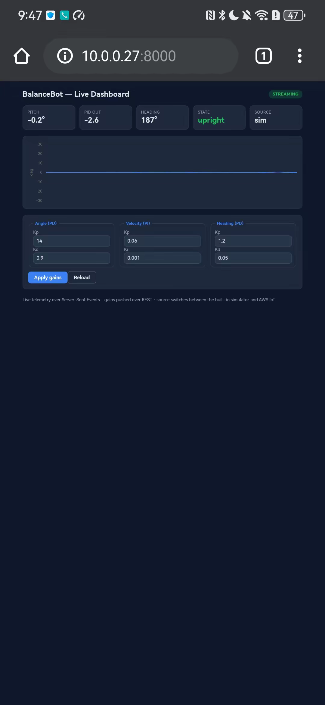

# BalanceBot

A two-wheel robot that balances on its own and drives over Bluetooth.

| Balancing and taking a push | Status screen |
|:---:|:---:|
|  |  |

I built this on a TARKBOT R3T chassis. The balance controller is XTARK's, the company that makes the chassis: an angle loop, a speed loop and a turn loop that run 100 times a second off the IMU's data-ready interrupt. My part was to move that controller onto an STM32F103 "Blue Pill" with hand-wired modules, write new motor and Bluetooth drivers for it, and get the cart to stand up and stay up.

## What I did

I wrote a new motor driver for the TB6612 board, because the vendor's code drove a different H-bridge. It runs both motors from two 20 kHz PWM channels on one timer.

The vendor's firmware could already tune gains over Bluetooth and save settings to flash, through a framed protocol for its own phone app. I replaced that protocol with single-character commands that any Bluetooth serial app can send. Bytes come in through an interrupt into a small ring buffer. I also rewrote the flash save. The gains go to the last page of internal flash with the valid marker written last, and if the read-back doesn't match, the OLED says the save failed.

I also added a six-channel telemetry stream on the UART, every 20 ms. That's how I found the sign error below.

## Problems I ran into

When I pushed the cart, it sped up instead of braking. The telemetry showed the speed loop adding to the push instead of fighting it, so its sign was wrong for this cart's motors. I added a setting that flips the sign live and saves it, and put a short brake test into the [tuning guide](STM32/TUNING.en.md) so the sign gets checked before the speed loop is tuned.

Even with good gains the cart kept rocking slowly back and forth, and no PD gain fixed it. The motors don't turn until the PWM gets past a certain level, so the small corrections did nothing. I added dead-zone compensation, tuned live to about 120 counts, and the wobble went away.

Cold starts from the battery sometimes failed. The IMU was initialized before it had finished powering up, so the DMP never loaded and the balance interrupt never fired. A reset fixed it, because by then the power was already up. The firmware now waits 1.5 s at boot and retries the IMU setup up to 10 times.

## CC3200 version

| Balancing | Status screen |
|:---:|:---:|
|  |  |

The second build runs on a TI CC3200 and started as my final project for EEC 172 (Embedded Systems) at UC Davis in Spring 2026. It's bare-metal C: an adapted Kalman filter for tilt, an angle PD loop, a power-on self-test and I2C bus recovery. When the cart falls past 35 degrees it stops the motors and posts one alert to an AWS IoT Thing Shadow over TLS, using the Wi-Fi code from a course lab. That firmware now has its own repository with unit tests and CI: [cc3200-balancing-cart](https://github.com/ChenSiyun1234/cc3200-balancing-cart).

## Apps

I also wrote three small apps around the robot. There's an Android remote in Kotlin that talks classic Bluetooth, a desktop remote in Python, and a web dashboard that reads telemetry from a small Python API. The API has a 20 Hz simulator, so I could work on the dashboard without the robot on the desk.

| Android remote driving the cart | Dashboard on a phone |
|:---:|:---:|
|  |  |

## Build it

- STM32: open `STM32/Project/xproject.uvprojx` in Keil µVision 5, build, and flash over SWD. Wiring is in [STM32/WIRING.en.md](STM32/WIRING.en.md) and tuning steps are in [STM32/TUNING.en.md](STM32/TUNING.en.md).
- CC3200: see [CC3200/README.md](CC3200/README.md) or the standalone repository.
- Apps: each one has its own README: [Android](android-app/README.md), [web dashboard and API](companion-app/README.md), [desktop](desktop-controller/README.md).

The parts list is in [hardware/BOM.en.md](hardware/BOM.en.md). The control loop diagram, the hardware table and the repository layout are in [docs/details.md](docs/details.md).

## Credits

- XTARK, maker of the TARKBOT R3T: the balance control law in `STM32/Robot/ax_balance.c` is theirs and is used as is, along with the starting gains, the FreeRTOS task setup and the files marked "adapted from XTARK OpenCTR".
- EEC 172, UC Davis: the CC3200 Wi-Fi and TLS code (`CC3200/src/network_utils.c/.h`) comes from the course's `aws-rest-api-ssl-demo` lab project, which builds on TI's SimpleLink SSL example. The OLED graphics are Adafruit GFX as ported for the course.
- Kristian Lauszus (TKJ Electronics): the Kalman filter math in `CC3200/src/kalman.c` follows his KalmanFilter library (GPL-2.0).
- FreeRTOS, ST's StdPeriph library, InvenSense's motion driver and TI's CC3200 SDK.

My own code is under the MIT license in `LICENSE`. XTARK's files and the other third-party code keep their owners' terms.
